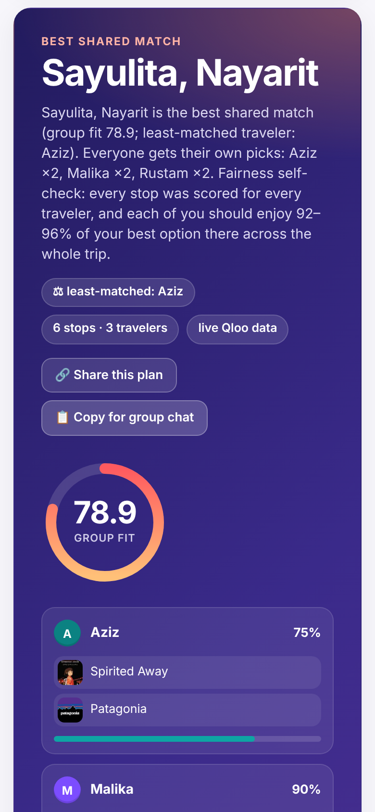
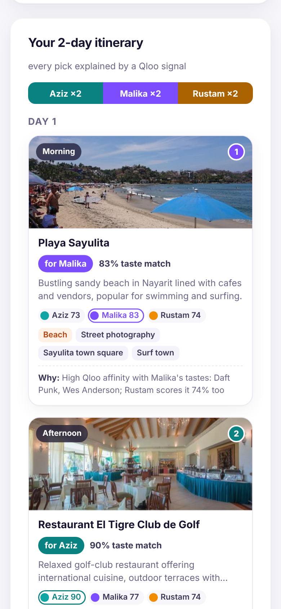

# TasteMatch Trips — a group-travel agent that's fair to everyone's taste

> This README describes the audited repository version. Check the demo's `/version` endpoint against the
> repository commit to see which version is deployed before relying on the behavior described here.

**Qloo Agentic Hackathon** · [](https://github.com/heavycastles/tastematch-trips/actions/workflows/ci.yml) · [MIT License](LICENSE) · Built by heavycastles

Group trips fail on taste: one friend wants anime museums, another techno clubs, the third street food.
Trip planners optimise for "the group average" and someone always loses. **TasteMatch Trips** asks each
traveler for 2-3 cultural favourites (movies, artists, brands, shows - use nicknames and public favourites)
and runs a fairness-aware agent over the **Qloo Taste AI** API.

**Live demo:** https://tastematch-trips.vercel.app — no login. Tap **Load sample**, or enter your own group
(1–6 nicknames, up to 3 favourites each, 1–5 days, optionally your own destination) and press **Plan our trip**.
Then hit **Share this plan** — the link re-creates the same group and re-plans it live for whoever opens it.

[](https://tastematch-trips.vercel.app)

**Historical demo video (2:24):** [`docs/demo-v5.mp4`](docs/demo-v5.mp4) records an earlier live-Qloo build
from 24 Oct. It predates the audit and describes logged trace steps as calls; its actual HTTP count is unverified.

### Why this needs Qloo (an LLM alone can't do it)

An LLM can *say* "Sayulita has something for everyone". It can't **measure** it. TasteMatch Trips asks Qloo the
same question for every person: how strongly do *Aziz's* tastes (Spirited Away, Patagonia) point to this city, to
this beach, to this restaurant — and then *Malika's*, and *Rustam's*. Fairness becomes a number the agent can
optimise and check, not a vibe:

- **Cross-domain:** a movie + a clothing brand → a surf town, its beach and a golf-club restaurant. That jump is Qloo's taste graph.
- **Cross-scoring requests for every traveler** (`filter.entities`), for cities *and* for individual stops - so
  available affinities can show how each traveler's tastes relate to a candidate.
- **Verifiable:** Qloo supplies the underlying scores; group-fit and whole-trip scores are calculated from them,
  and logical tool steps are shown in the agent trace.

## What it does

1. **resolve_entity** — `GET /search` turns each favourite into a Qloo entity (unmatched ones are reported, never guessed).
2. **destination_affinity** — `GET /v2/insights?filter.type=urn:entity:destination&signal.interests.entities=…`
   for the whole group (with `filter.popularity.min` so tiny towns don't dominate), then once per traveler
   with `filter.entities=<group candidates>` to request each city's per-traveler affinity. Qloo sometimes lists
   one city twice ("Oaxaca" and "Oaxaca City", "Mexico City" and "Distrito Federal, Mexico City"); entries within
   15 km of a higher-ranked one are merged, so the ranking shows each city once (the trace shows how many were merged).
3. **fairness ranking** — `group_fit = 40% mean + 40% minimum + 20% group affinity`, so a city that thrills two
   friends and bores the third ranks below one everyone likes. The "least-matched traveler" is shown. This is a
   heuristic: it assumes scores from separate traveler queries are comparable, which has not been established here.
4. **local_places** — `GET /v2/insights?filter.type=urn:entity:place&filter.location.query=<City, Region>` per traveler.
   Qloo's place graph includes hotels, condos and errands (pet stores, clinics, banks), so the agent asks for 40
   venues and keeps the top 8 a group would actually visit, using Qloo's `urn:tag:category:place:*` tags (offices,
   salons, campuses, gyms and studios are dropped unless Qloo also tags them as a sight), plus a distance check that
   drops outliers more than 100 km from the city's venues (the trace shows how many were skipped). If filtering
   leaves no suitable places, the original results may be used instead and the UI warns about this fallback.
   Each stop card shows its venue type.
5. **cross_score_places** - requests scores for every candidate stop from step 4 for **every** traveler with
   `filter.entities=<all candidate stops>` + the same location, forming an affinity matrix when scores are available.
6. **itinerary (plan → self-check → re-plan)** — the agent acts on that matrix:
   - *compensate:* the traveler the city fits least picks first each round;
   - *group-aware picks:* on your turn you get one of **your** top-tier stops (within 3 points of your best),
     and among those the agent takes the one that best lifts whoever in the group is furthest behind;
   - *self-check:* it computes how much each person should enjoy the **whole** trip (mean affinity over all
     stops, relative to their own best option in the city, because some tastes score high everywhere) and,
     when all candidate scores are available. If the gap is over 5 points, it re-plans once with the least-satisfied traveler first and a wider window,
     keeping the revision only if the gap shrinks. Every decision is shown in the UI ("What the agent decided").
   - *time of day:* cafés, sights, viewpoints, shops and beaches go to the morning/afternoon and dinner, bars
     and stadiums to the evening (a night club that doesn't fit an evening goes to an afternoon, never a morning),
     swapping across days when needed; only the slot changes (same stops, owners and
     scores), so fairness is untouched. If there are more travelers than stops, the plan says who has no own pick yet.
   Each stop cites its owner's Qloo affinity, the favourites it came from, and available scores for everyone else. The pitch is a deterministic summary of those facts; if
   `LLM_BASE_URL`/`LLM_API_KEY` are set, an LLM rewrites it from the same facts (not enabled on the hosted demo).

**Your own destination:** type a city (e.g. *Lisbon*) and the agent resolves it with `GET /search`
(`types=urn:entity:destination`), scores it for every traveler alongside Qloo's own candidates, and shows
"Your destination" with its group fit next to Qloo's top pick — instead of pretending your city was the best match.
If Qloo has no city-level affinity for your pick, the plan says "not scored by Qloo" rather than showing a fake 0.

**Incomplete Qloo data:** a city missing a group score or a score for any traveler is excluded from the ranking and the trace
reports skipped cities; an incompletely scored chosen city is labeled unscored. For places, missing scores are
omitted, group-aware optimization and re-planning require complete candidate scores, and the whole-trip check is
shown only if every candidate stop has a score for everyone.

**Honest failure modes:** unknown favourites are listed and skipped (the trace shows which Qloo entity each favourite
matched; favourites are capped at 100 characters, and a favourite entered twice counts once); an unknown destination, duplicate nicknames
or an empty form get a plain-language message; Qloo rate limits (429, bounded back-off ≤ 12 s, honours
`Retry-After`) and timeouts return 503/504 (the whole plan has a 45 s time budget, so a slow Qloo never hits the 60 s function limit) with a "Try again" button — never a raw stack trace or upstream payload.

The web UI shows the best shared match (group-fit ring, per-traveler fit, matched favourites with Qloo images),
the fairness ranking, a photo itinerary with "for whom" tags, provenance and available per-traveler stop scores,
the **Fairness self-check** when scores are complete (whole-trip enjoyment per traveler + the agent's decisions),
a map of the stops (Qloo coordinates) and a trace of logical tool steps. This version separately counts
actual Qloo HTTP attempts and cached lookups; retries and alternate searches may share a trace step. **Share this plan** copies a link
that encodes the group's inputs (nicknames, favourites, days, destination, but no results);
**Copy for group chat** copies the itinerary as text. Responses are cached in memory only, never stored in the
repo. Results are presented as aggregate affinities, not predictions about individuals (per Qloo's safe-use guide).

## Live example (verified 13 Oct 2026, re-run on the hosted demo 27 Oct 2026)

Against `https://hackathon.api.qloo.com` (`X-Api-Key`). Sample group: Aziz (Spirited Away, Patagonia),
Malika (Daft Punk, Wes Anderson), Rustam (Anthony Bourdain, Chef's Table) — all six entities resolved.

| Rank | Destination | group_fit | least-matched |
| ---: | --- | ---: | --- |
| 1 | **Sayulita, Nayarit** | 78.9 | Aziz |
| 2 | Santa Fe, New Mexico | 78.6 | Malika |
| 3 | Ojai, California | 77.4 | Malika |

Fair itinerary (2 days): Aziz ×2, Malika ×2, Rustam ×2. In that recorded run every stop was scored for the whole
group, e.g. Mita Mary - Rustam's pick (0.80) that Aziz scores 0.88 and Malika 0.80; Playa Sayulita - Malika's pick
(0.83). Fairness self-check on the hosted demo (27 Oct): whole-trip enjoyment Aziz 92% · Malika 93% · Rustam 96%
(gap 4 pts, 3 stops swapped for group-friendlier options), 16 logged steps in ~4 s.
Earlier sanitized sample (before cross-scoring): [`docs/live-sample.md`](docs/live-sample.md).

## Screenshots (hosted demo, live Qloo API, 27 Oct 2026)

Taken from https://tastematch-trips.vercel.app (real hackathon `QLOO_API_KEY`, 16 logged steps, plan in ~4 s) with the
fictional sample group, at 1280 px and on a 390 px phone viewport. Place photos are the images Qloo returns for each place.

| Best shared match | Fairness ranking |
|---|---|
|  |  |
| **Fair itinerary (Day 1)** | **Map + agent trace** |
|  |  |
| **Fairness self-check** | **Every stop scored for every traveler** |
|  |  |
| **Sample group** | **Agent at work** |
|  |  |
| **Phone (390 px): best match** | **Phone (390 px): itinerary** |
|  |  |

All screenshots: [`docs/screenshots/`](docs/screenshots/) (incl. full page `09-full-page.png`).

## Architecture

```
Travelers (nicknames + cultural likes)
        │
        ▼
FastAPI  POST /api/plan  ──► plan()                         app/agent.py
                              ├─ resolve_entity  /search
                              ├─ destination_affinity  /v2/insights (group + per traveler)
                              ├─ fairness()  mean + min + group affinity
                              ├─ local_places  /v2/insights place + location
                              ├─ cross_score_places  /v2/insights place + filter.entities (traveler × stop)
                              ├─ build_itinerary  compensate → group-aware picks → self-check → re-plan once
                              └─ narrate()  template from Qloo facts (optional LLM rewrite)
        │
        ▼
Web UI (/)  match card · fairness ranking · photo itinerary · fairness self-check · map · agent trace
            · share link (#plan=…) · copy for group chat · live|mock badge
n8n/telegram-group-trip.json  → Telegram group bot
```

Qloo client: `app/qloo.py` — base `https://hackathon.api.qloo.com`, header `X-Api-Key`, in-process LRU cache, per-traveler calls run in parallel (up to 6 at once),
bounded retry on HTTP 429, a per-request time budget, typed errors (rate limit / timeout / bad location / upstream). Without `QLOO_API_KEY` a built-in mock taste graph is used (`source: mock`).

## Run

```bash
cp .env.example .env               # QLOO_API_KEY from the hackathon key form
python -m venv .venv && .venv/bin/pip install -r requirements-dev.txt
.venv/bin/pytest -q                # optional live smoke skips without a key
.venv/bin/python serve.py          # loads .env; http://localhost:8080 → "Load sample" → "Plan our trip"
docker compose up --build          # app :8080 + n8n :5678
```

Hackathon keys only work on `https://hackathon.api.qloo.com` with the `X-Api-Key` header.
Never commit `.env` or the API key.

Local audit on 28 Oct 2026: **157 tests passed, 1 optional live smoke test skipped** without a Qloo key.
The earlier `dc63f95` baseline's offline run had 131 passed and 1 skipped.

The public planning endpoint has no per-user or global request limit in this repository. Caching, input limits
and time budgets reduce some work but do not cap usage: opening a share link starts a new plan, and uncached
requests can consume Qloo quota and hosting resources. Account allowances and any charges depend on the actual
Qloo and hosting account terms; they cannot be determined from this repository.

## API

| Method | Path | |
|---|---|---|
| GET | `/healthz` | `{ok, qloo: live\|mock}` |
| GET | `/version` | `{version, commit, qloo}` — which commit the hosted demo runs |
| GET | `/api/sample` | demo travelers (Aziz / Malika / Rustam) |
| POST | `/api/plan` | body: `{travelers, days, destination?}` → ranking, itinerary (Qloo image, coordinates, `group_scores` per traveler), `fairness_check`, `decisions`, trace, stats |

Example:

```json
POST /api/plan
{"travelers":[{"label":"Aziz","likes":[{"name":"Spirited Away","type":"movie"}]}],"days":2}
```

## Submission pack

- Devpost write-up: [`SUBMISSION.md`](SUBMISSION.md)
- Demo script: [`docs/video-script.md`](docs/video-script.md)
- Slides PDF: [`docs/slides.pdf`](docs/slides.pdf) · cover: [`docs/cover.png`](docs/cover.png)
- **Historical demo video:** [`docs/demo-v5.mp4`](docs/demo-v5.mp4) (2:24; recording of earlier commits
  bf3b2ea and f46114e). It predates this audit; its trace-count narration is not a verified HTTP count.
  See its [historical script](docs/video-script-v5.md). Earlier cuts are archival and uncorrected: [`docs/demo-v4.mp4`](docs/demo-v4.mp4),
  [`docs/demo-v3.mp4`](docs/demo-v3.mp4), [`docs/demo-v2.mp4`](docs/demo-v2.mp4).
- Earlier live draft: [`docs/demo-live-draft.mp4`](docs/demo-live-draft.mp4) (1:59, script [`docs/video-script-live.md`](docs/video-script-live.md))
- Older draft (slides + narration): [`docs/demo-draft.mp4`](docs/demo-draft.mp4)
- Screenshots of the live run: [`docs/screenshots/`](docs/screenshots/)


## Deploy demo (Render)

One-click free-tier demo. Config: `render.yaml` (Docker, Oregon, health `/healthz`).
`QLOO_API_KEY` is prompted by Render (`sync: false`) — never put the key in git.
`QLOO_BASE_URL` defaults to `https://hackathon.api.qloo.com`. Without a key the app serves the offline mock graph.

1. Open [Render Blueprint](https://dashboard.render.com/select-repo?type=blueprint), connect `heavycastles/tastematch-trips`, Apply.
2. Paste the hackathon API key when Render asks for `QLOO_API_KEY`.
3. Open the service URL, tap **Load sample** → **Plan our trip**.

```bash
docker build -t tastematch-trips .
docker run --rm -p 8080:8080 -e QLOO_BASE_URL=https://hackathon.api.qloo.com tastematch-trips
# curl http://localhost:8080/healthz   # qloo: mock without key
```

## Deploy demo (Vercel)

The same FastAPI app also runs on Vercel (Hobby plan is enough) as a single Python function.
Vercel picks up `app/main.py` automatically; `vercel.json` only sets the function time limit to 60 s
(a recorded plan for three travelers showed 16 logical steps in ~4 s; per-traveler calls run in parallel,
so a group of four or more stays well inside the 45 s plan budget). Python 3.13 is pinned in `.python-version`.
`.vercelignore` is an allow-list: only `app/`, `requirements.txt`, `VERSION` and a few small files are uploaded,
never `.env`, tests, docs or videos.

```bash
npm i -g vercel
vercel login
vercel link                                   # create/link the project once
# set the key from your local .env without echoing it (never commit it)
grep '^QLOO_API_KEY=' .env | cut -d= -f2- | tr -d '\n' | vercel env add QLOO_API_KEY --environment production
vercel deploy --prod -e GIT_COMMIT=$(git rev-parse --short HEAD)   # /version then reports the commit
curl https://<your-project>.vercel.app/healthz   # {"ok":true,"qloo":"live"}
```

`QLOO_BASE_URL` defaults to `https://hackathon.api.qloo.com`, so it doesn't need to be set.
Without `QLOO_API_KEY` the deployed app falls back to the offline mock graph.

## License

MIT — see [`LICENSE`](LICENSE) (Copyright (c) 2026 heavycastles).
