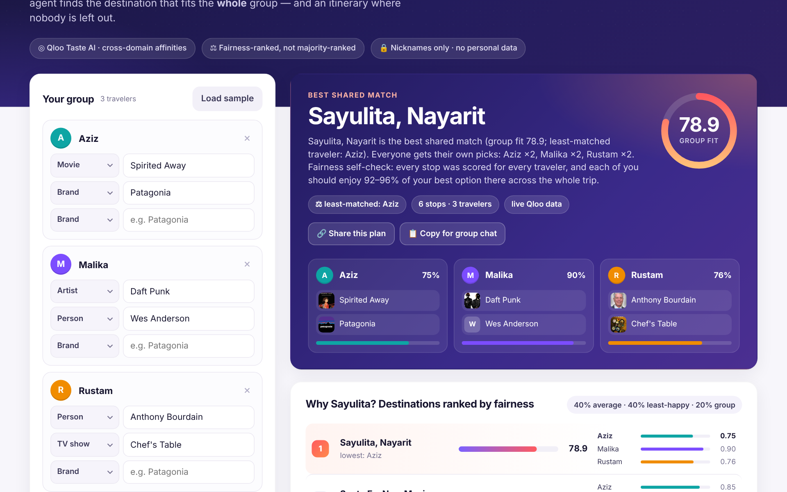
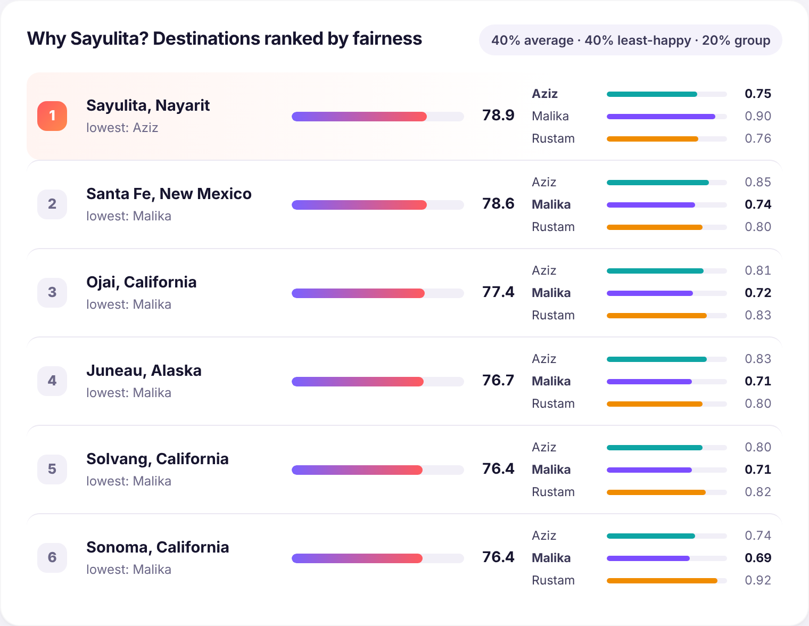
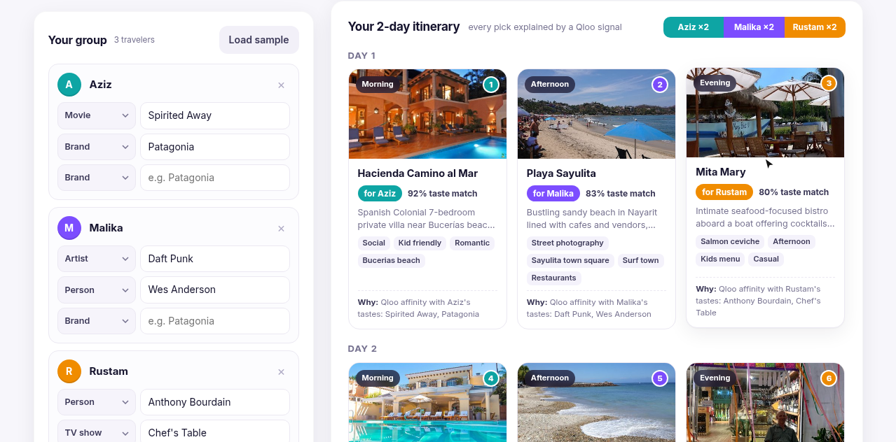
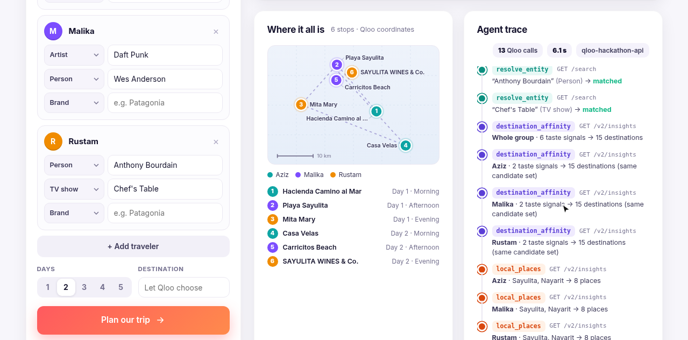
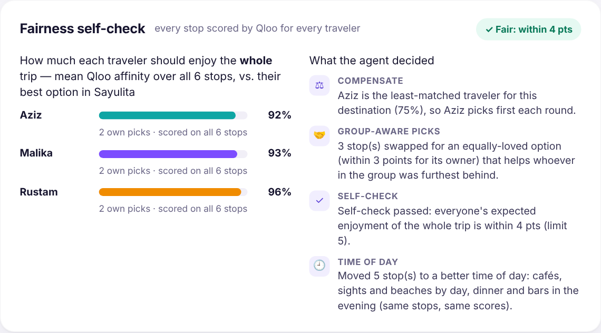
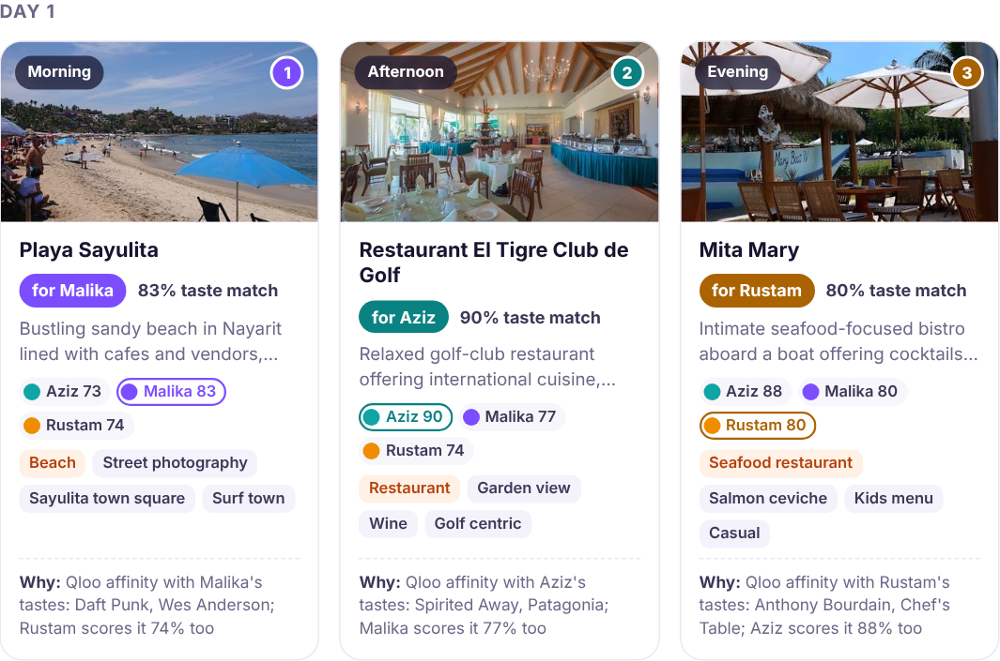
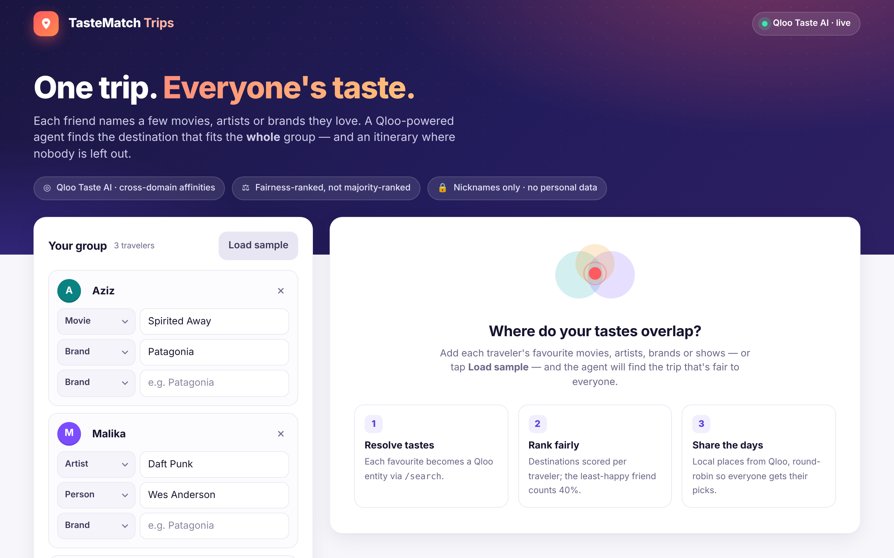
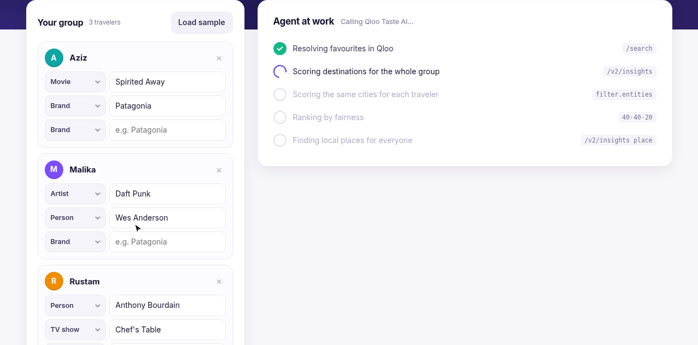
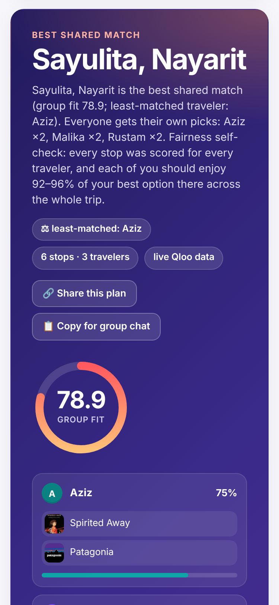
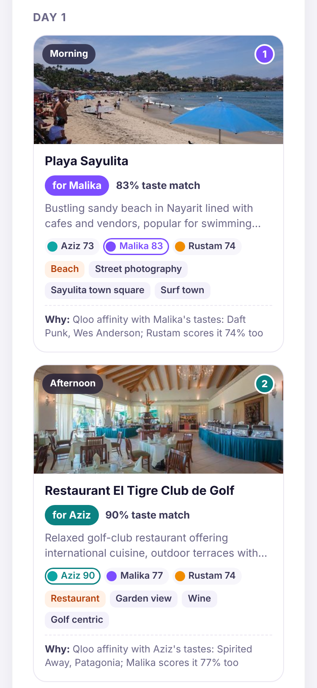

# TasteMatch Trips — a group-travel agent that's fair to everyone's taste

**Qloo Agentic Hackathon** · [](https://github.com/heavycastles/tastematch-trips/actions/workflows/ci.yml) · [MIT License](LICENSE) · Built by heavycastles

Group trips fail on taste: one friend wants anime museums, another techno clubs, the third street food.
Trip planners optimise for "the group average" and someone always loses. **TasteMatch Trips** asks each
traveler for 2–3 cultural favourites (movies, artists, brands, shows — **nicknames only, no personal data**)
and runs a fairness-aware agent over the **Qloo Taste AI** API.

**Live demo:** https://tastematch-trips.vercel.app — no login. Tap **Load sample**, or enter your own group
(1–6 nicknames, up to 3 favourites each, 1–5 days, optionally your own destination) and press **Plan our trip**.
Then hit **Share this plan** — the link re-creates the same group and re-plans it live for whoever opens it.

### Why this needs Qloo (an LLM alone can't do it)

An LLM can *say* "Sayulita has something for everyone". It can't **measure** it. TasteMatch Trips asks Qloo the
same question for every person: how strongly do *Aziz's* tastes (Spirited Away, Patagonia) point to this city, to
this beach, to this restaurant — and then *Malika's*, and *Rustam's*. Fairness becomes a number the agent can
optimise and check, not a vibe:

- **Cross-domain:** a movie + a clothing brand → a surf town, its beach and a golf-club restaurant. That jump is Qloo's taste graph.
- **Every candidate scored for every traveler** (`filter.entities`), for cities *and* for individual stops — so
  the agent knows not just who a stop is for, but how much everyone else will enjoy it.
- **Verifiable:** every number on screen is a Qloo affinity, every call is in the agent trace, nothing is invented.

## What it does

1. **resolve_entity** — `GET /search` turns each favourite into a Qloo entity (unmatched ones are reported, never guessed).
2. **destination_affinity** — `GET /v2/insights?filter.type=urn:entity:destination&signal.interests.entities=…`
   for the whole group (with `filter.popularity.min` so tiny towns don't dominate), then once per traveler
   with `filter.entities=<group candidates>` so every city gets a real per-traveler affinity.
3. **fairness ranking** — `group_fit = 40% mean + 40% minimum + 20% group affinity`, so a city that thrills two
   friends and bores the third ranks below one everyone likes. The "least-matched traveler" is shown.
4. **local_places** — `GET /v2/insights?filter.type=urn:entity:place&filter.location.query=<City, Region>` per traveler.
   Qloo's place graph includes hotels, condos and errands (pet stores, clinics, banks), so the agent asks for 40
   venues and keeps the top 8 a group would actually visit, using Qloo's `urn:tag:category:place:*` tags (offices,
   salons, campuses, gyms and studios are dropped unless Qloo also tags them as a sight), plus a distance check that
   drops outliers more than 100 km from the city's venues (the trace shows how many were skipped). Each stop card
   shows its venue type.
5. **cross_score_places** — every candidate stop from step 4 is scored for **every** traveler with
   `filter.entities=<all candidate stops>` + the same location, giving a traveler × stop affinity matrix.
6. **itinerary (plan → self-check → re-plan)** — the agent acts on that matrix:
   - *compensate:* the traveler the city fits least picks first each round;
   - *group-aware picks:* on your turn you get one of **your** top-tier stops (within 3 points of your best),
     and among those the agent takes the one that best lifts whoever in the group is furthest behind;
   - *self-check:* it computes how much each person should enjoy the **whole** trip (mean affinity over all
     stops, relative to their own best option in the city, because some tastes score high everywhere) and,
     if the gap is over 5 points, re-plans once with the least-satisfied traveler first and a wider window,
     keeping the revision only if the gap shrinks. Every decision is shown in the UI ("What the agent decided").
   - *time of day:* cafés, sights, viewpoints, shops and beaches go to the morning/afternoon and dinner, bars
     and stadiums to the evening (a night club that doesn't fit an evening goes to an afternoon, never a morning),
     swapping across days when needed; only the slot changes (same stops, owners and
     scores), so fairness is untouched. If there are more travelers than stops, the plan says who has no own pick yet.
   Each stop cites its owner's Qloo affinity, the favourites it came from, and its score for everyone else. The pitch is a deterministic summary of those facts; if
   `LLM_BASE_URL`/`LLM_API_KEY` are set, an LLM rewrites it from the same facts (not enabled on the hosted demo).

**Your own destination:** type a city (e.g. *Lisbon*) and the agent resolves it with `GET /search`
(`types=urn:entity:destination`), scores it for every traveler alongside Qloo's own candidates, and shows
"Your destination" with its group fit next to Qloo's top pick — instead of pretending your city was the best match.
If Qloo has no city-level affinity for your pick, the plan says "not scored by Qloo" rather than showing a fake 0.

**Honest failure modes:** unknown favourites are listed and skipped (the trace shows which Qloo entity each favourite
matched; favourites are capped at 100 characters); an unknown destination, duplicate nicknames
or an empty form get a plain-language message; Qloo rate limits (429, bounded back-off ≤ 12 s, honours
`Retry-After`) and timeouts return 503/504 with a "Try again" button — never a raw stack trace or upstream payload.

The web UI shows the best shared match (group-fit ring, per-traveler fit, matched favourites with Qloo images),
the fairness ranking, a photo itinerary with "for whom" tags, provenance and per-traveler scores on every stop,
the **Fairness self-check** (whole-trip enjoyment per traveler + the agent's decisions), a map of the stops (Qloo
coordinates) and the full agent trace (each Qloo call, with call count and time). **Share this plan** copies a link
that encodes only the group's inputs (nicknames, favourites, days, destination — no results, no personal data);
**Copy for group chat** copies the itinerary as text. Responses are cached in memory only, never stored in the
repo. Results are presented as aggregate affinities, not predictions about individuals (per Qloo's safe-use guide).

## Live example (verified 13 Oct 2026, re-run on the hosted demo 23 Oct 2026)

Against `https://hackathon.api.qloo.com` (`X-Api-Key`). Sample group: Aziz (Spirited Away, Patagonia),
Malika (Daft Punk, Wes Anderson), Rustam (Anthony Bourdain, Chef's Table) — all six entities resolved.

| Rank | Destination | group_fit | least-matched |
| ---: | --- | ---: | --- |
| 1 | **Sayulita, Nayarit** | 78.9 | Aziz |
| 2 | Santa Fe, New Mexico | 78.6 | Malika |
| 3 | Ojai, California | 77.4 | Malika |

Fair itinerary (2 days): Aziz ×2, Malika ×2, Rustam ×2. Since 22 Oct every stop is also scored for the whole
group, e.g. Mita Mary — Rustam's pick (0.80) that Aziz scores 0.88 and Malika 0.80; Playa Sayulita — Malika's pick
(0.83). Fairness self-check on the hosted demo (23 Oct): whole-trip enjoyment Aziz 92% · Malika 93% · Rustam 96%
(gap 4 pts, 3 stops swapped for group-friendlier options), 16 Qloo calls in ~4 s.
Earlier sanitized sample (before cross-scoring): [`docs/live-sample.md`](docs/live-sample.md).

## Screenshots (hosted demo, live Qloo API, 23 Oct 2026)

Taken from https://tastematch-trips.vercel.app (real hackathon `QLOO_API_KEY`, 16 Qloo calls, plan in ~4 s) with the
fictional sample group, at 1280 px and on a 375 px phone viewport. Place photos are the images Qloo returns for each place.

| Best shared match | Fairness ranking |
|---|---|
|  |  |
| **Fair itinerary (Day 1)** | **Map + agent trace** |
|  |  |
| **Fairness self-check** | **Every stop scored for every traveler** |
|  |  |
| **Sample group** | **Agent at work** |
|  |  |
| **Phone (375 px): best match** | **Phone (375 px): itinerary** |
|  |  |

All screenshots: [`docs/screenshots/`](docs/screenshots/) (incl. full page `09-full-page.png`).

## Architecture

```
Travelers (nicknames + cultural likes)
        │
        ▼
FastAPI  POST /api/plan  ──► plan()                         app/agent.py
                              ├─ resolve_entity  /search
                              ├─ destination_affinity  /v2/insights (group + per traveler)
                              ├─ fairness()  mean + min + group affinity
                              ├─ local_places  /v2/insights place + location
                              ├─ cross_score_places  /v2/insights place + filter.entities (traveler × stop)
                              ├─ build_itinerary  compensate → group-aware picks → self-check → re-plan once
                              └─ narrate()  template from Qloo facts (optional LLM rewrite)
        │
        ▼
Web UI (/)  match card · fairness ranking · photo itinerary · fairness self-check · map · agent trace
            · share link (#plan=…) · copy for group chat · live|mock badge
n8n/telegram-group-trip.json  → Telegram group bot
```

Qloo client: `app/qloo.py` — base `https://hackathon.api.qloo.com`, header `X-Api-Key`, in-process LRU cache,
bounded retry on HTTP 429, typed errors (rate limit / timeout / bad location / upstream). Without `QLOO_API_KEY` a built-in mock taste graph is used (`source: mock`).

## Run

```bash
cp .env.example .env               # QLOO_API_KEY from the hackathon key form
python -m venv .venv && .venv/bin/pip install -r requirements-dev.txt
.venv/bin/pytest -q                # 65 tests (offline mock + live smoke if key present)
.venv/bin/python serve.py          # loads .env; http://localhost:8080 → "Load sample" → "Plan our trip"
docker compose up --build          # app :8080 + n8n :5678
```

Hackathon keys only work on `https://hackathon.api.qloo.com` with the `X-Api-Key` header.
Never commit `.env` or the API key.

## API

| Method | Path | |
|---|---|---|
| GET | `/healthz` | `{ok, qloo: live\|mock}` |
| GET | `/api/sample` | demo travelers (Aziz / Malika / Rustam) |
| POST | `/api/plan` | body: `{travelers, days, destination?}` → ranking, itinerary (Qloo image, coordinates, `group_scores` per traveler), `fairness_check`, `decisions`, trace, stats |

Example:

```json
POST /api/plan
{"travelers":[{"label":"Aziz","likes":[{"name":"Spirited Away","type":"movie"}]}],"days":2}
```

## Submission pack

- Devpost write-up: [`SUBMISSION.md`](SUBMISSION.md)
- Demo script: [`docs/video-script.md`](docs/video-script.md)
- Slides PDF: [`docs/slides.pdf`](docs/slides.pdf) · cover: [`docs/cover.png`](docs/cover.png)
- **Demo video:** [`docs/demo-v4.mp4`](docs/demo-v4.mp4) (2:24, screen recording of the hosted demo at tastematch-trips.vercel.app: every stop scored for every traveler, real venues only (hotels and errands filtered out) ordered by time of day, the fairness self-check with re-plan, share link and copy-for-group-chat; script [`docs/video-script-v4.md`](docs/video-script-v4.md), subtitles [`docs/demo-v4.srt`](docs/demo-v4.srt)). Previous cuts: [`docs/demo-v3.mp4`](docs/demo-v3.mp4) (2:20, recorded before the venue filter), [`docs/demo-v2.mp4`](docs/demo-v2.mp4) (1:54, incl. the own-destination flow)
- Earlier live draft: [`docs/demo-live-draft.mp4`](docs/demo-live-draft.mp4) (1:59, script [`docs/video-script-live.md`](docs/video-script-live.md))
- Older draft (slides + narration): [`docs/demo-draft.mp4`](docs/demo-draft.mp4)
- Screenshots of the live run: [`docs/screenshots/`](docs/screenshots/)


## Deploy demo (Render)

One-click free-tier demo. Config: `render.yaml` (Docker, Oregon, health `/healthz`).
`QLOO_API_KEY` is prompted by Render (`sync: false`) — never put the key in git.
`QLOO_BASE_URL` defaults to `https://hackathon.api.qloo.com`. Without a key the app serves the offline mock graph.

1. Open [Render Blueprint](https://dashboard.render.com/select-repo?type=blueprint), connect `heavycastles/tastematch-trips`, Apply.
2. Paste the hackathon API key when Render asks for `QLOO_API_KEY`.
3. Open the service URL, tap **Load sample** → **Plan our trip**.

```bash
docker build -t tastematch-trips .
docker run --rm -p 8080:8080 -e QLOO_BASE_URL=https://hackathon.api.qloo.com tastematch-trips
# curl http://localhost:8080/healthz   # qloo: mock without key
```

## Deploy demo (Vercel)

The same FastAPI app also runs on Vercel (Hobby plan is enough) as a single Python function.
Vercel picks up `app/main.py` automatically; `vercel.json` only sets the function time limit to 60 s
(a live plan for three travelers makes ~16 Qloo calls and usually takes 4–8 s). Python 3.13 is pinned in `.python-version`.
`.vercelignore` is an allow-list: only `app/`, `requirements.txt`, `VERSION` and a few small files are uploaded,
never `.env`, tests, docs or videos.

```bash
npm i -g vercel
vercel login
vercel link                                   # create/link the project once
# set the key from your local .env without echoing it (never commit it)
grep '^QLOO_API_KEY=' .env | cut -d= -f2- | tr -d '\n' | vercel env add QLOO_API_KEY --environment production
vercel deploy --prod
curl https://<your-project>.vercel.app/healthz   # {"ok":true,"qloo":"live"}
```

`QLOO_BASE_URL` defaults to `https://hackathon.api.qloo.com`, so it doesn't need to be set.
Without `QLOO_API_KEY` the deployed app falls back to the offline mock graph.

## License

MIT — see [`LICENSE`](LICENSE) (Copyright (c) 2026 heavycastles).
